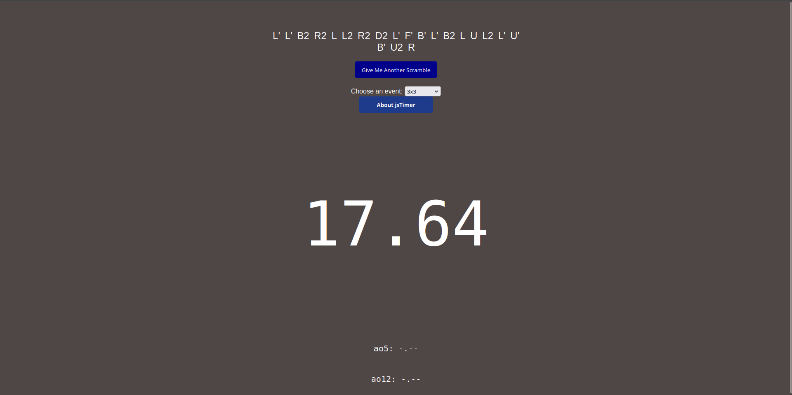

# jsTimer

A no-nonsense, minimalist cube timer built with vanilla JavaScript, HTML and CSS.



## Features

- **Clean, distraction-free timer** for speedcubing
- **ao5**: the average of your last 5 solves
- **ao12**: the average of your last 12 solves
- Runs entirely in your browser

## Try it

**[Open jsTimer](https://jstimer.lab26.my)**

## Run locally

```bash
git clone https://github.com/zllai26/jsTimer.git
cd jsTimer
```

Then open `index.html` in your browser. No build step or dependencies needed.

## Contributing and issues

Found a bug or have an idea? You can:

- Open an issue in the [Issues](https://github.com/zllai26/jsTimer/issues) tab
- Submit a pull request to the `main` branch
- Contact me via [my homepage](https://github.com/zllai26)

## License

Released under the [GPL-3.0 license](LICENSE).
